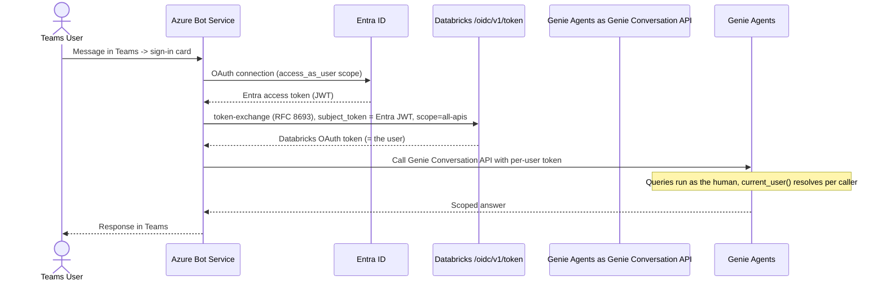

# Microsoft Teams / Copilot Studio → Genie Agents & Agent Bricks with Per-User Identity

> **What this is**: Per-user identity into Genie Agents/Agent Bricks from Microsoft Teams or Copilot Studio is real and supported. The caller must use an end-user identity, and that identity must map to an existing Databricks user with access to the agent and underlying data.
>
> **Azure-specific.** Entra ID as the IdP; Azure Bot Service is Azure infrastructure.

This completes the Microsoft-surface picture alongside the sibling pattern:

| Pattern | Front-end | Token exchange | RLS granularity |
|---|---|---|---|
| [Power BI → Agent Bricks OBO](federation-implementation-blueprint.md) | Power BI Embedded (MSAL) | RFC 8693, account-wide | Individual, platform-enforced |
| **This doc** — Teams/Copilot Studio → Genie Agents/Agent Bricks | Azure Bot Service or Copilot Studio | RFC 8693, account-wide (custom path) or Copilot Studio's own OAuth | Individual, when end-user credentials are used |

---

## The two permission checks

1. **Caller identity**: the caller used per-user OBO/token-exchange, not a shared SP/M2M credential.
2. **Data authorization**: Unity Catalog evaluates the end user's grants, row filters, and column masks.

**Both must be true.** The current Genie Agent documentation distinguishes compute access from data access: embedded author credentials can provide access to the SQL warehouse, while Unity Catalog data authorization is still evaluated as the end user.

Do not infer the caller's data permissions from the warehouse credential. Verify them with two users who have different Unity Catalog grants.

---

## Four integration paths, mapped

| Path | Token-layer identity | Confidence |
|---|---|---|
| Custom AI agent + Azure Bot Service + OAuth federation | Per-user OBO — `current_user()` = human | Confirmed, code-traced against the official reference implementation |
| Copilot Studio via MCP, "End user credentials" | Per-user (U2M) | Confirmed to exist |
| Copilot Studio via MCP, "Maker credentials" | Shared — everyone runs as the maker's identity | Confirmed M2M by design, not a degraded OBO mode |
| Native "Databricks Genie Agents" app (Teams marketplace) | Per-user, Entra sign-in required | Confirmed per-user ([Databricks Genie Agents app in Microsoft Teams](https://docs.databricks.com/aws/en/integrations/msft-teams)) |
| Native "Databricks Genie Agents on Microsoft 365 Copilot" | Per-user, same Entra sign-in pattern as the Teams app | Confirmed per-user ([Databricks Genie Agents on Microsoft 365 Copilot](https://docs.databricks.com/aws/en/integrations/msft-m365-copilot)) |

The native "Databricks Genie Agents" marketplace app uses **per-user authentication**: each user signs in with Entra ID, and `current_user()` resolves to that human. The Microsoft 365 Copilot native app follows the same Entra sign-in pattern. Confirm before rollout: two users with different UC grants ask the same question, then compare results and `system.access.audit`.

### Native Teams app: capabilities and constraints

The native marketplace app trades configurability for a turnkey setup. Plan around these characteristics before choosing it over the custom Azure Bot Service path:

| Characteristic | Native Teams app |
|---|---|
| Authentication | Per-user Entra sign-in; Unity Catalog evaluates end-user data permissions |
| PrivateLink | Not available. When IP access lists are enforced, allowlist the outbound IPs of the Databricks control plane for the workspace's region |
| Compute | Automatic warehouse selection; users cannot pick a SQL warehouse |
| Chart visualizations | Text answers only; charts are outside the app's scope |
| Outbound notifications (Teams to Databricks actions) | Outside the app's scope |
| Response visibility | An admin can limit responses to direct messages only, rather than channel messages |

When you need PrivateLink, an explicit warehouse choice, charts, or write-back actions, use the custom Azure Bot Service pattern below, which gives you full control over each of these. The native app is the fastest route when a turnkey, per-user Genie Agents experience in Teams is the goal.

---

## Confirmed path — Custom agent + Azure Bot Service + OAuth federation



The exchange, following the [Connect an AI agent to Microsoft Teams](https://learn.microsoft.com/en-us/azure/databricks/generative-ai/agent-framework/teams-agent) reference pattern:

```python
url = f"{databricks_host}/oidc/v1/token"
data = {
    "grant_type": "urn:ietf:params:oauth:grant-type:token-exchange",
    "subject_token": provider_oauth_token,      # Entra JWT from the Teams OAuth prompt
    "subject_token_type": "urn:ietf:params:oauth:token-type:jwt",
    "scope": "all-apis",
    # no client_id — omitting it is what keeps this per-user rather than SP
}
response = await http_client.post(url, data=data)
oauth_db_token = response.json()["access_token"]
workspace_client = WorkspaceClient(host=databricks_host, token=oauth_db_token)
```

After obtaining the per-user token, you can call the Genie Conversation API directly with the token, or use a Model Serving agent (such as Agent Bricks) that automatically forwards the OBO token. Both approaches carry the same per-user identity into Databricks.

This is the same account-wide RFC 8693 exchange as [Per-User BYO-IdP Federation](byoidp-peruser-federation.md). Teams/Azure Bot Service is a new front-end for a pattern already documented here, using the same mechanism.

**Setup, condensed** (full steps: [Connect an AI agent to Microsoft Teams](https://learn.microsoft.com/en-us/azure/databricks/generative-ai/agent-framework/teams-agent)):

1. Create Azure resources: resource group, App Service Plan, Web App, **Azure Bot** (Single Tenant).
2. Configure the Bot's Entra app: redirect URI `https://token.botframework.com/.auth/web/redirect`, optional claim `preferred_username`, exposed scope `access_as_user`, Graph delegated permissions `email`/`openid`/`profile`, `requestedAccessTokenVersion: 2`.
3. Add an OAuth Connection on the Azure Bot (Azure Active Directory v2, scope `api://<app_id>/access_as_user`).
4. Create a Databricks OAuth federation policy (issuer, audience = the Entra app ID, subject claim `preferred_username`).
5. Deploy the bot code with `DATABRICKS_HOST`, Genie Agents workspace URL or serving endpoint name, and Microsoft App credentials as env vars.

---

## Copilot Studio via MCP — "End user credentials"

The Copilot Studio MCP connector to Genie Agents offers an explicit toggle between shared M2M ("Maker credentials") and per-user ("End user credentials"). Selecting the latter produces the same effect as the custom-bot path above, where `current_user()` resolves to the human. See [Databricks Genie Agents on Microsoft 365 Copilot](https://docs.databricks.com/aws/en/integrations/msft-m365-copilot) for the connector setup.

---

## Gotchas

| Issue | Detail |
|---|---|
| Confusing compute and data credentials | Embedded author credentials can provide warehouse access, while Unity Catalog still evaluates data permissions as the end user. Test the data result and audit identity, not only the warehouse setting. |
| `client_id` in the token exchange | Omit it. Including it selects a service principal and collapses RLS to the SP. |
| `preferred_username` vs other claims | The federation policy's subject claim must match what the exchanged JWT actually carries in your tenant. |
| Two unrelated things named "Genie Agents + Teams" | The native marketplace app and the custom Azure Bot Service pattern are different integrations with different, differently-documented identity models. Confirm which one is in play before answering an RLS question. |
| "Maker credentials" in Copilot Studio | Intentionally shared/M2M by design — a deliberate mode choice, not per-user OBO. |

---

## Related

- [Per-User BYO-IdP Federation](byoidp-peruser-federation.md) — the general pattern this specializes for Teams/Copilot Studio
- [Federation blueprint](federation-implementation-blueprint.md) — RFC 8693 exchange recipe this reuses
- [Authorization](authorization.md) — the three token patterns overview
- [Row filters and column masks](https://docs.databricks.com/aws/en/data-governance/unity-catalog/filters-and-masks/) — how Unity Catalog enforces end-user data permissions

## Public References

- [Connect an AI agent to Microsoft Teams](https://learn.microsoft.com/en-us/azure/databricks/generative-ai/agent-framework/teams-agent)
- [Databricks Genie Agents app in Microsoft Teams](https://docs.databricks.com/aws/en/integrations/msft-teams)
- [Databricks Genie Agents on Microsoft 365 Copilot](https://docs.databricks.com/aws/en/integrations/msft-m365-copilot)
